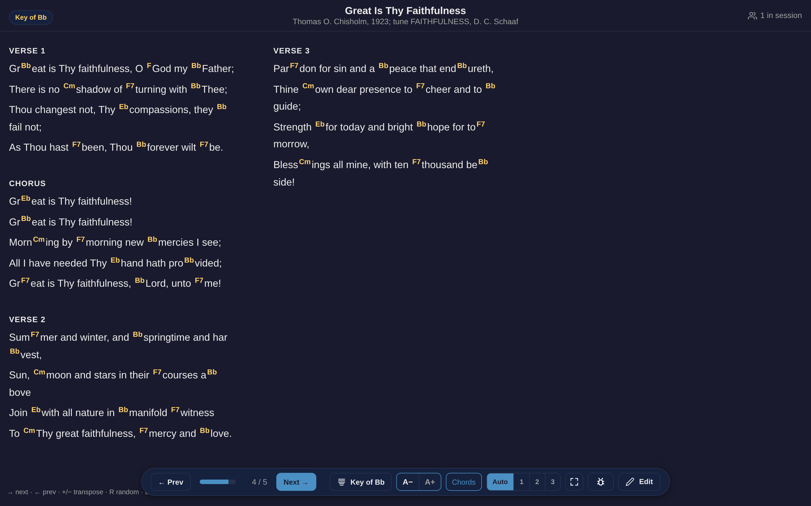
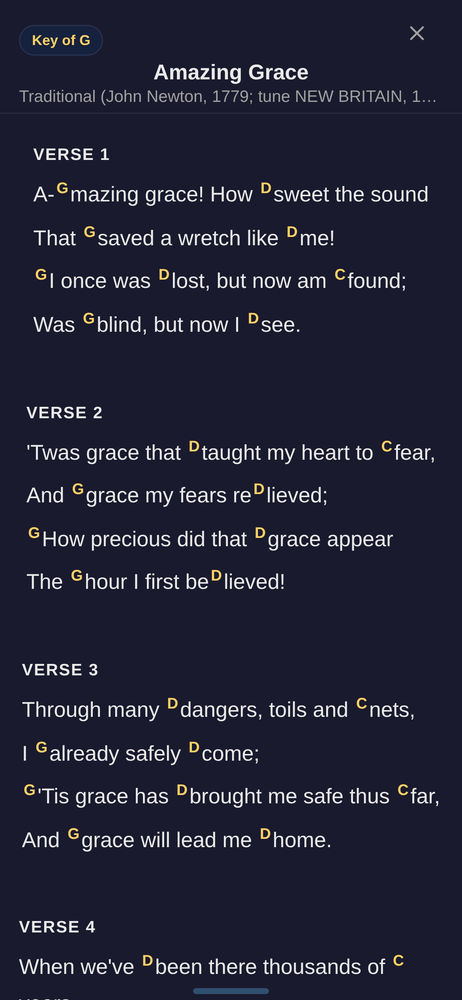
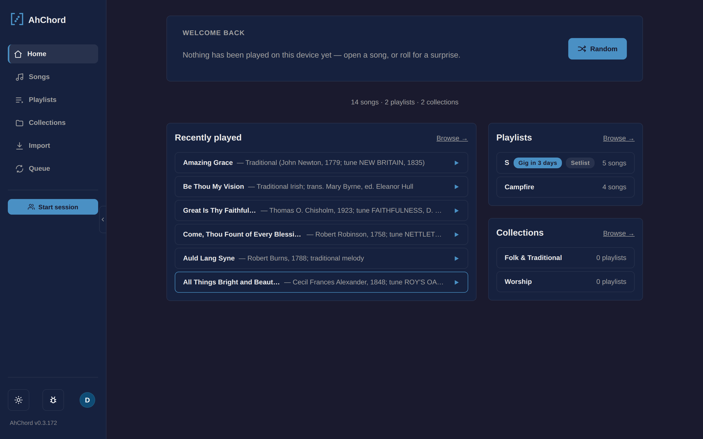
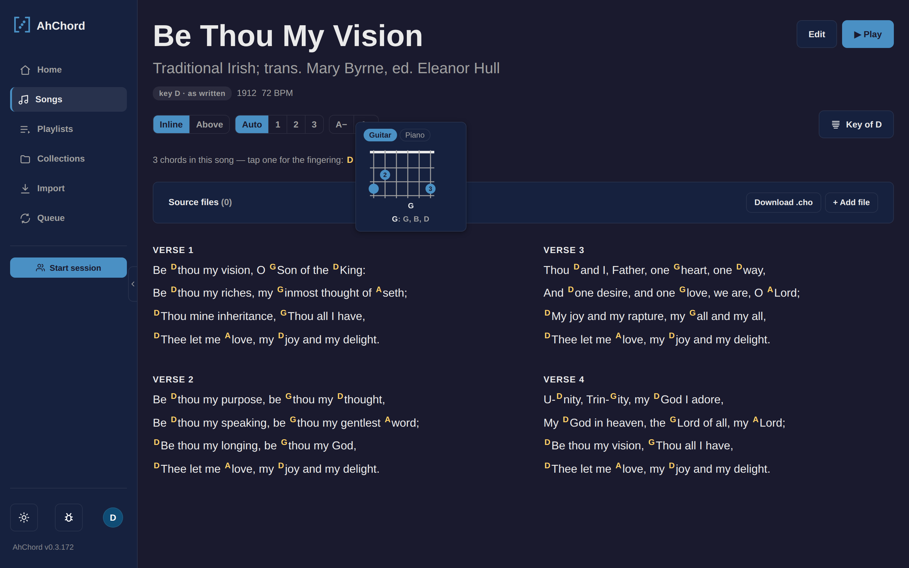

# AhChord — Chord Chart Manager & Visualiser

Keep your band's chord charts on **your own server** — and stay in control of them.
Paste a chart, play it full-screen, hand it to the band: start a setlist session and
everyone follows the same song, in the same key, live.

[](https://github.com/BunnyDad18/AhChord/actions/workflows/ci.yml)


[](LICENSE)

- **Web app + Android app** — play on the laptop, the stage tablet, the phone
- **Self-hosted with Docker** — one image + Postgres; your charts never leave your server
- **Share with your band** — a shared library, playlists, collections, setlists
- **Play together** — real-time setlist sync: every device follows the host's song and key
- **ChordPro all the way down** — plain `.cho` text is the source of truth; open it in any editor, keep it forever

## Support AhChord

AhChord is free and open source (MIT). It is built to help bands organise their music using their own servers. If you would like to support the developer and see continued development please consider donating, a coffee helps:

[](https://www.paypal.biz/bunnydad18)
[](https://ko-fi.com/bunnycodingdev)

## Screenshots

<table>
  <tr>
    <td width="62%" align="center"></td>
    <td width="38%" align="center"></td>
  </tr>
  <tr>
    <td colspan="2"><em>Full-screen player, Phone Player</em></td>
  </tr>
  <tr>
    <td align="center"></td>
    <td align="center"></td>
  </tr>
  <tr>
    <td colspan="2"><em>Library dashboard, and the song view with a chord-diagram popover.</em></td>
  </tr>
</table>

## Features

- **ChordPro as the source of truth** — paste, edit, and play standard `.cho` content; chords and sections render from the text
- **Capo & transpose** — pick a capo (0–6) for a song, transpose a live session by ear; the displayed chords update everywhere, the stored chart never changes
- **Play together** — SignalR setlist sessions: everyone sees the same song and the same key, live; a general follow mode tracks the host while they browse
- **Playlists, collections & setlists** — organize by Worship / Events / Home; a *setlist* is a playlist in performance mode, with a gig date
- **Fullscreen player** — big Next button, 1–3 column layout, font scaling, keyboard + touch navigation
- **Chord diagrams** — hover/focus any chord for SVG **guitar finger positions** or **piano key positions** (your choice)
- **Convert a chord page** — paste a chord page's text and a local LLM (Ollama / LM Studio, any OpenAI-compatible endpoint) turns it into ChordPro; review, then import. No LLM configured? The full prompt is built in — copy it into any chat LLM
- **MusicBrainz search** — auto-fill artist/year while editing
- **Multi-user** — register/login, shared library, per-user recent songs
- **Android app** — the APK in [Releases](https://github.com/BunnyDad18/AhChord/releases) runs standalone on the device, or against your server
- **Dark mode native**, keyboard-accessible

## Quick start (Docker)

Pull the built image — no clone, no build. Save this as `compose.yaml`:

```yaml
services:
  app:
    image: ghcr.io/bunnydad18/ahchord:latest
    ports:
      - "5001:5000"
    environment:
      ASPNETCORE_ENVIRONMENT: Production
      ConnectionStrings__DefaultConnection: "Host=postgres;Port=5432;Database=ahchord;Username=ahchord;Password=CHANGE_ME"
      JWT_SECRET: "long-random-string"   # e.g.: openssl rand -hex 32
    depends_on:
      postgres:
        condition: service_healthy
    restart: unless-stopped

  postgres:
    image: postgres:16-alpine
    environment:
      POSTGRES_USER: ahchord
      POSTGRES_PASSWORD: CHANGE_ME
      POSTGRES_DB: ahchord
    volumes:
      - ahchord_db:/var/lib/postgresql/data
    healthcheck:
      test: ["CMD-SHELL", "pg_isready -U ahchord -d ahchord"]
      interval: 10s
      timeout: 5s
      retries: 5
    restart: unless-stopped

volumes:
  ahchord_db:
```

```bash
docker compose up -d
```

## Stack

| Layer | Tech |
|---|---|
| Backend | .NET 10 · ASP.NET Core · EF Core 10 · Npgsql · Identity + JWT · SignalR · Scalar |
| Frontend | React 18 · Vite · TypeScript · Zustand · react-router · CSS modules · hand-rolled SVG |
| Data | PostgreSQL 16 |
| Infra | Docker |

## Roadmap

- **In-app phone updates** — the Android app checks GitHub Releases and offers the new version itself
- **Server update nudge** — the admin sees an in-app note when a new release is out
- **Safer public connections** — stronger security so the app can face networks beyond the LAN
- **Per-musician capo in sessions** — follow the host's song and key, pick your own capo
- **Better session sync controls** — the host steers what everyone follows, more precisely
- **Chords above the words** — chord symbols aligned directly over the syllable they belong to
- **More file formats** — parsers for other chord-sheet formats, not just pasted text
- **Print & PDF export** — a song or setlist on paper for the players who work that way
- **Tempo & metronome** — per-song BPM with an in-player click for rehearsal
- **Horn-friendly keys** — per-musician display transposition (E♭ / B♭) in shared sessions, display-only
- **UI refresh** — a modern component vocabulary; the hand-rolled SVG chord diagrams stay

## Documentation

Please visit the [documentation site](https://bunnydad18.github.io/AhChord/) for a guide on using the software:

- **User guide** — first song, player, setlists & live sync, import, mobile & offline
- **Deployment guide** — configuration, reverse proxy, backups
- **Conversion prompt** — the built-in prompt behind chord-page conversion
- **Security notes** — reporting and hardening
- **[Contributing](CONTRIBUTING.md)** — dev loop, gates, the invariants a PR must keep
- **[Changelog](CHANGELOG.md)** — user-facing changes

## License

MIT (application code). Hangfire (the optional conversion queue) is Apache-2.0.
