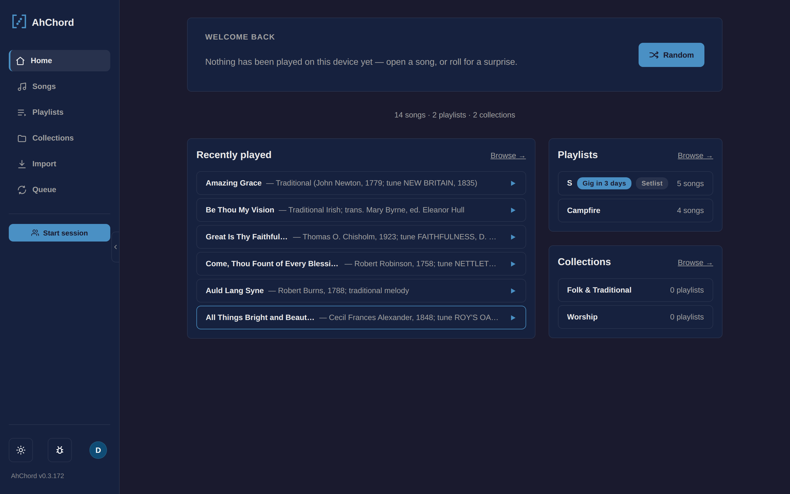
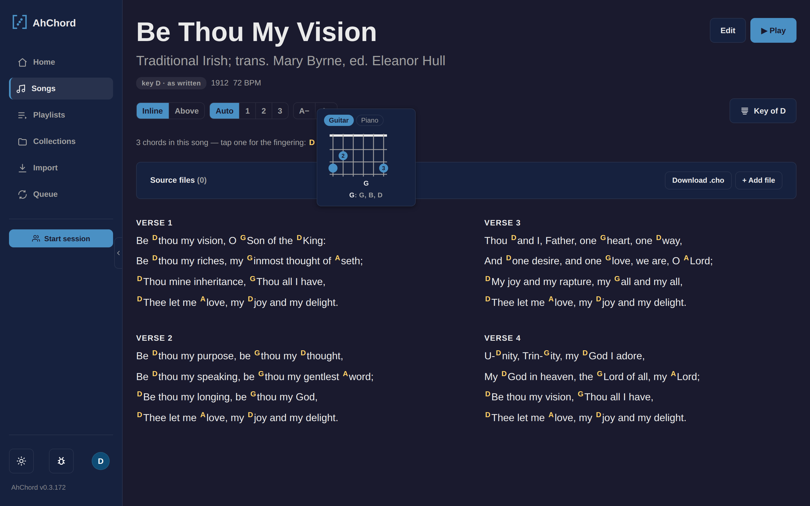
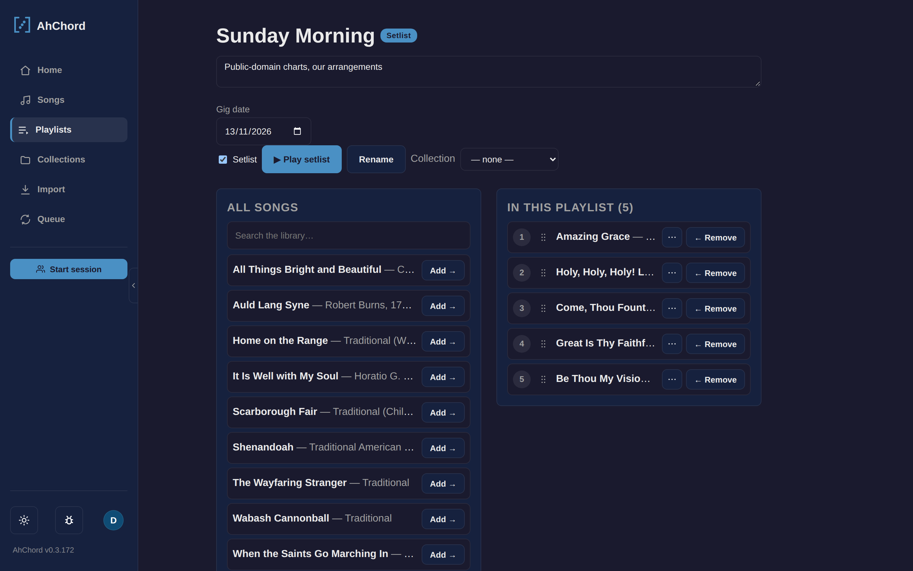
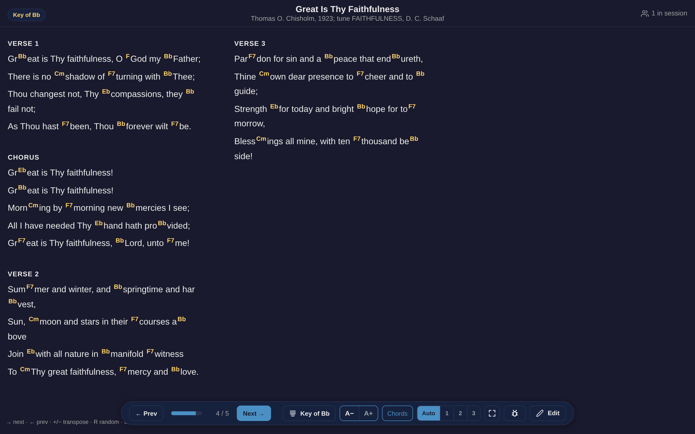
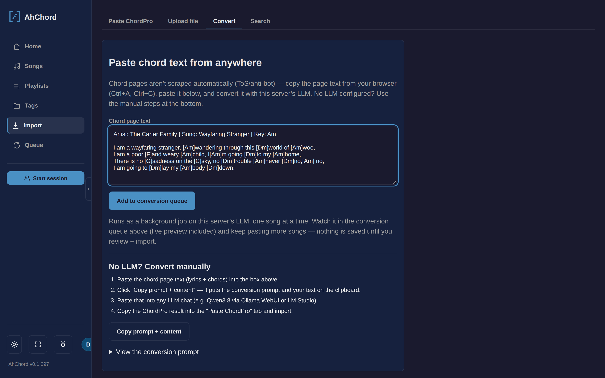
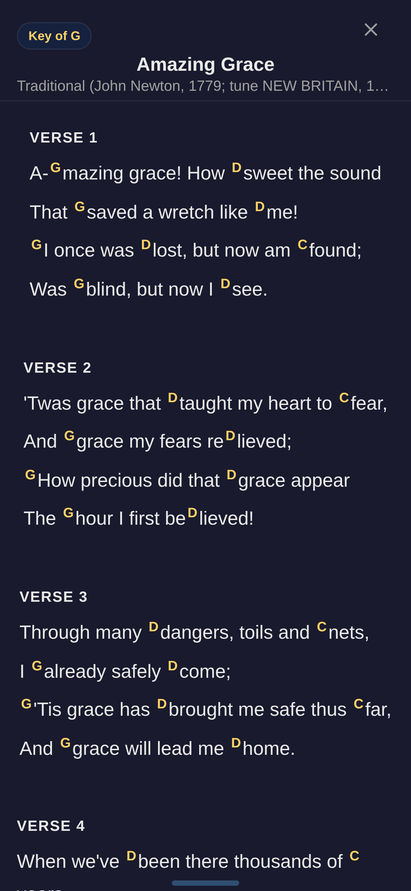

# Screenshots

The images in this folder are the ones shown in the README and on the
[documentation site's front page](../../index.md). They are all
from a **throwaway instance** of this app — a Compose stack on loopback with a fresh, empty
database — driven by [Playwright](https://playwright.dev) against the built container. Nothing
here comes from anyone's real library.

## The set

| | |
|---|---|
|  |  |
| Library dashboard | Song view, chord-diagram popover |
|  |  |
| Setlist with a gig date | Full-screen player (long song, columns) |
|  |  |
| Import / convert | Phone player |

## What the songs are

Every chart in these screenshots is **public-domain lyrics with our own chord arrangement**:
hymns, spirituals, and traditional songs whose published text is old enough to be in the public
domain (Amazing Grace, Be Thou My Vision, Come Thou Fount, Auld Lang Syne, Shenandoah, …).
The chord symbols, section layout, keys, tempos and capo choices are ours.

- No song with copyright-protectable text is bundled in this repository, and none appears here.
- No CCLI / modern-worship material, and no 20th-century arrangement of a traditional song
  (the Animals' *House of the Rising Sun* is exactly that — the song is traditional, that
  arrangement is not, so it is excluded).
- The demo chart set lives outside this repository. A fresh install starts with an empty
  library on purpose (see `docs/tasks/ST-91.md`).

## How to reproduce them

1. Build this tree into a container and run it with its own Postgres on a loopback port, with a
   volume name that cannot collide with a real deployment.
2. Register a user, then import the public-domain chart set and build two collections, one
   playlist and one setlist (a setlist with a gig date is what the setlist screens show).
3. Drive the UI headlessly at 1440×900 @2x (desktop) and 390×844 @3x (phone) and capture:
   dashboard, song view, chord-diagram popover, setlist, player, capo, import.

The capo screenshot is not a mock: the player shows the *projected* shapes (a chart written in
G with capo 2 displays F/C/A♯ shapes that sound in G), which is the app's capo model — display
only, the stored chart never changes.
