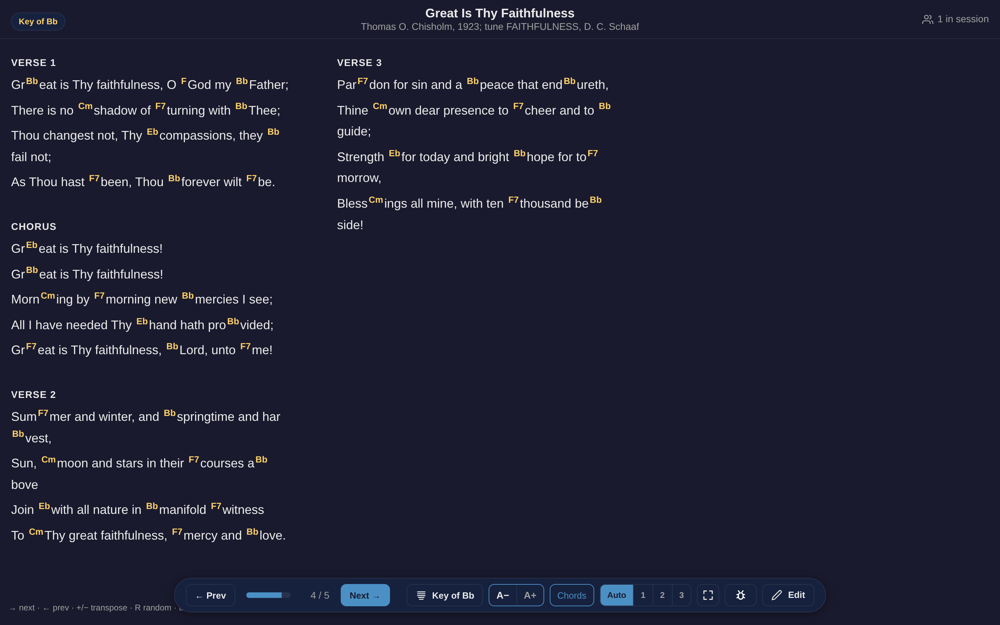

# AhChord User Guide

How to use AhChord once it's running. This guide is for **players and band members** —
the person performing with a chart, the person running the setlist at a gig, the person
keeping the library tidy. Setting the server up is covered by the
[deployment guide](../DEPLOYMENT.md); this starts the first time you open the app.

## Start here

| Page | What's in it |
|---|---|
| [Getting started](getting-started.md) | First login, first song, first play — the first ten minutes |
| [Library & songs](library-and-songs.md) | Browsing, searching, the song view, chord diagrams, the capo & transposition model, the editor |
| [The player](player.md) | Fullscreen performance mode: layout, columns, font, keyboard, random-song mode |
| [Setlists & sessions](setlists-and-sessions.md) | Playlists, collections, gig setlists, live band sync, follow sessions |
| [Import](import.md) | Paste ChordPro, upload files, convert a chord page with a local LLM, search & wishlist |
| [Mobile & offline](mobile-and-offline.md) | The Android app (phone/tablet/TV), PWA install, offline library |
| [Settings](settings.md) | Appearance, chord diagram default, LLM endpoint, bug reports, About |
| [Shortcuts & FAQ](shortcuts-and-faq.md) | Keyboard reference and the honest answers to common questions |
| [ChordPro basics](chordpro-basics.md) | A mini reference for writing charts by hand |

## The shape of the app in one paragraph

AhChord stores **ChordPro** charts (plain text with chords in square brackets) as the
single source of truth. You register an account on your own server, build a shared
library of songs, group them into **playlists** — a *setlist* is a playlist in
performance mode — and **collections**. The **fullscreen player** renders charts with
inline chords, lets you capo and transpose **display-only** (the stored chart is never
rewritten), and **syncs the whole band in real time**: everyone on the setlist sees the
same song, in the same key. Songs arrive by pasting, uploading `.cho`/`.txt` files, or
converting a pasted chord page with your own local LLM. Everything runs in one Docker
container on your network, and your phone, tablet, laptop and TV all talk to the same
server.

