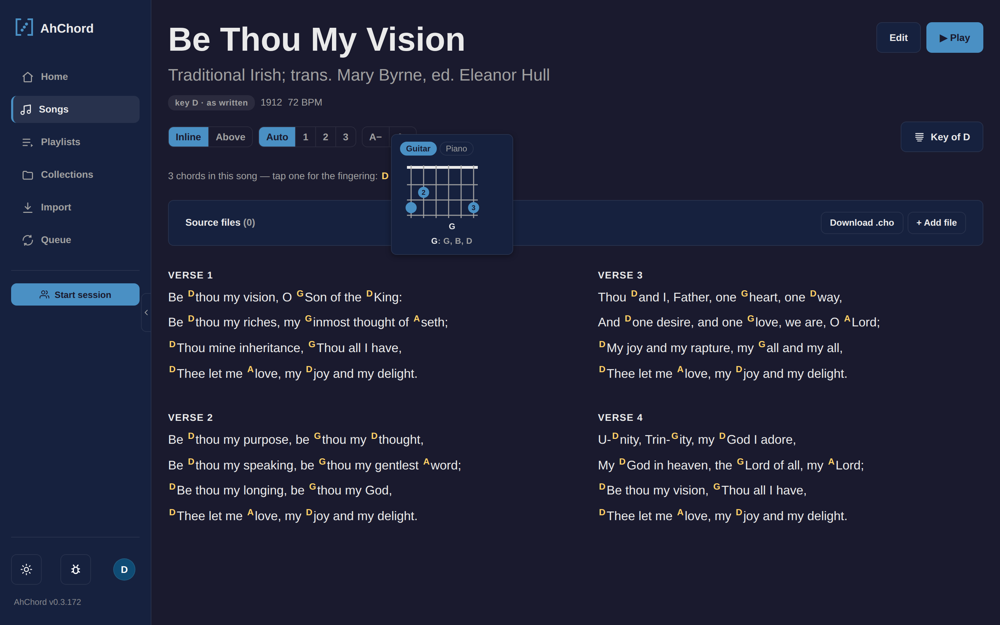

# Library & songs

Everything in AhChord revolves around the **song**: a ChordPro chart plus metadata,
shared by the whole band.

## Browsing and searching

**Songs** lists the whole library. Type in the search box (top of every page) to
match title or artist — results are debounced, `↑`/`↓` move through them, `Enter`
opens the song, `Esc` closes the list. On the Songs page you can additionally
filter by **artist, genre, decade** and sort by title/artist/date added. Scroll
position is restored when you come back.

The **dashboard** shows what you need on a normal day: recently played songs,
your playlists, collections, and *Play a random song*.

## The song view

Open a song and you get the chart with a header: title, artist, key badge, year,
**Edit** and **Play**.

- **Chord diagrams** — hover, focus (Tab) or tap any chord for a diagram: guitar
  finger positions **or** piano keys, with the note list ("F: F, A, C"). The
  guitar/piano choice persists; chords with no sane guitar shape fall back to piano.
  `Esc` closes the diagram and returns focus.
- **Capo selector (0–6)** — sets the song's capo (details below).
- **Source files** — attach the "real" sheet: PDFs, images, anything. Attached
  files preview inline under the header and can be downloaded or deleted.
- **Versions** — editing a song creates a new version; the library shows the
  latest, older ones stay available.

## The key, capo & transposition model

This is the one model worth understanding — everything else follows it:

> **The stored ChordPro text is the single source of truth and is never modified
> by display controls.** Capo and transposition are display-only transforms.

Concretely:

| Control | Range | What it does |
|---|---|---|
| **Capo** (per song) | frets 0–6 | Sets where the band caps. Stored with the song, so every device sees the same capo. |
| **Transpose** (live) | −12…+12 semitones | Shifts the displayed chords on the fly — in the player, per setlist, shared in a band session. Not stored. |

The chord *shapes* on screen = chart chords shifted by (transpose − capo), so a
chart written in G played "as written" with capo 2 shows F/C/A♯-family shapes that
**sound** in G. The top bar keeps a permanent chip: **Capo 2 · Key of G** — the key
you will hear. Pick a capo for a singer and nobody has to re-write a chart;
transpose for a horn key without touching the library.

## The editor

**Edit** (or **Songs → New song**) opens the editor: metadata fields plus the raw
ChordPro text with a **live preview** side by side. Tab inserts two spaces.

- **MusicBrainz "Look up"** finds matching releases and fills
  artist / album / year for you.
- **Unsaved-changes guard** — navigating away with unsaved edits asks first.
- **Delete** needs a type-to-confirm. The song's versions go with it; playlists
  just drop it.

## Metadata review

The server can scan the library and propose metadata fixes (artist, album, year,
key…) — proposals appear as a review panel on the song row and in a library-wide
review list: accept, reject, or accept a whole category. Nothing is applied
without you clicking Accept.

## What "shared library" means

There is one library, visible to every account, and edits are visible to
everyone — this is a band tool, not personal lockers. Per-user data is your
recently-played list, wishlist, and preferences. If you want write protection
on a public-facing instance, `LIBRARY_WRITES_ADMIN_ONLY` restricts deletes and
renames to the admin (a server setting — see the [deployment guide](../DEPLOYMENT.md)).
