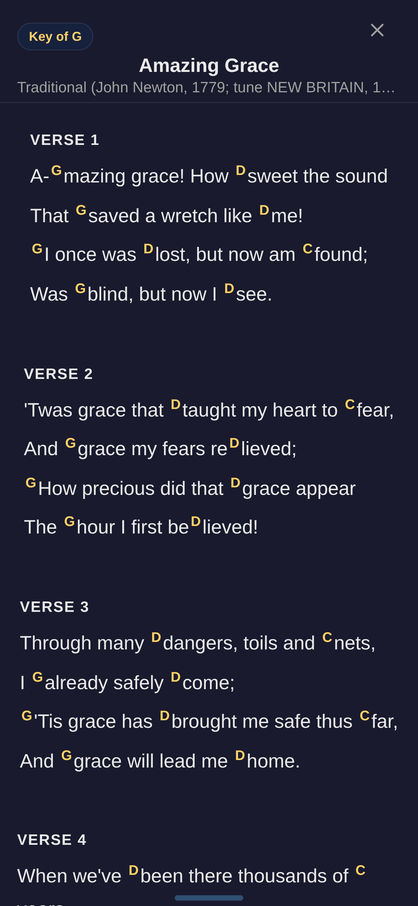

# Mobile & offline

One server, every device. Three ways to put AhChord on a phone, tablet or TV.

## The Android app

Your own server distributes the APK — no Play Store, no external hosting:

1. On the device, open the web app once (any browser) → **Settings → About →
   Download the Android app (.apk)**. (The row only appears once the
   administrator has published a build; it shows the current app version.)
2. Install the APK (Android asks to allow installs from this source).
3. First run asks for your **server address** — enter it (e.g.
   `http://192.168.1.20:5001`, or your `https://` domain). The app probes
   `/api/health` to confirm it reached the right place, then shows the login.

Details that matter:

- **Phone, tablet and Android TV** — one APK; on a TV (e.g. a Shield) it appears
  in the launcher and everything is drivable with the d-pad remote
  (arrows / Enter / Esc). A TV at the rehearsal room wall + phones in the band
  is a normal setup.
- **Sign-in state is in the Android Keystore** (encrypted at rest), not in web
  storage.
- **Bare addresses default sanely**: private/LAN hosts get `http://`, public
  hosts get `https://`; type a scheme to override.
- **Updates**: the app compares its version with the server's published build —
  the update prompt (and Settings → About) is the renewal path.

## PWA (any phone, iPad, laptop)

The web app is installable: browser menu → **Install app** / **Add to home
screen**. It runs standalone (no browser chrome) with the same logins, and the
cache below applies.

## Offline mode

On any installed client (PWA; the Android app behaves the same), AhChord keeps a
local copy of **what you use**: songs and playlists you've opened recently, plus
your recent list.

- Server reachable? Everything is live, as usual.
- Server down / no signal (venue basement, gig van)? An **offline banner**
  appears, and the app serves your cached library — charts render, the player
  works, gigs proceed.
- Writes you make while offline (play counts, small edits) are queued and
  pushed to the server when it's back.

What's cached is what you've opened — so before a gig, open your setlist once
with signal. (This is also why the first visit to a fresh device needs the
server: login and the first fetch of the library are online.)

## Which do I want?

| Device | Best |
|---|---|
| Android phone/tablet | **APK** — Keystore token, standalone, in-app updates |
| iPhone / iPad / laptop | **PWA** install from the browser |
| Android TV / Shield | **APK**, d-pad remote |
