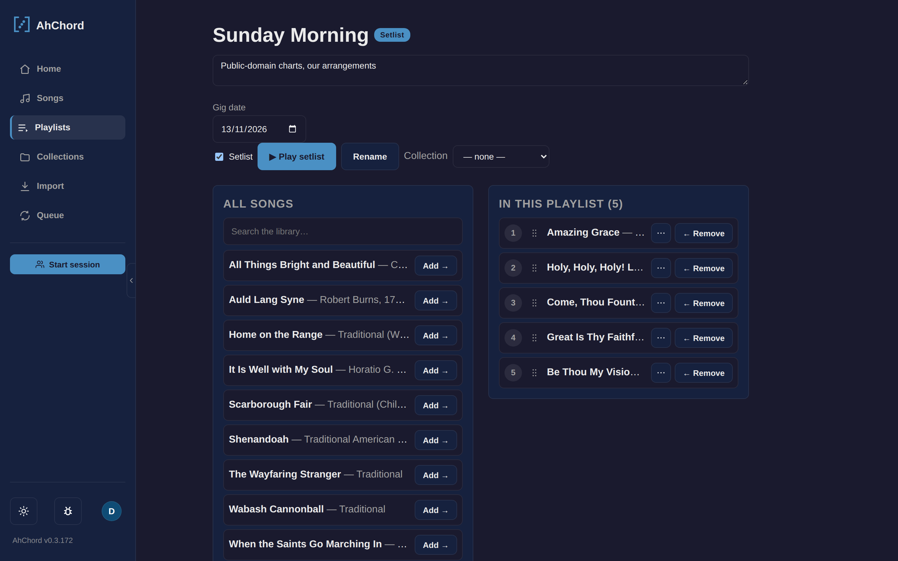

# The player

The player is the performance surface: fullscreen, big touch targets, keyboard-driven.
Two modes:

| Mode | URL | Behaviour |
|---|---|---|
| **Song** | `/songs/:id/player` | One song; `R` / the shuffle control jumps to a random song (random-song mode is handy in rehearsals). |
| **Setlist** | `/playlists/:id/player` | Steps through a setlist: **N / M** progress, and — with everyone joined — the band session below. |

## Controls you'll actually use

- **Next** — the large primary button; one thumb on a phone at a gig.
- **Prev / Next** — buttons, `→`/`↓` and `←`/`↑`, swipe-friendly targets on touch.
- **Esc** — leave the player.
- **`+` / `−`** — transpose ±1 semitone, shared instantly with the band in a session.
- **`R`** — random song (single-song mode).
- **PageUp / PageDown** — step one column when the chart is laid out in columns.
- **Key & capo chip** — "Capo 2 · Key of G" rides the top bar permanently; setting
  a capo never moves the layout.
- **Font scale** — 80–160 % for the whole chart (per device, remembered).
- **Columns** — Auto / 1 / 2 / 3 with fit-to-height; Auto picks columns so the
  chart fills the screen.
- **Position is remembered** per playlist on your device — reopen last night's
  setlist and you land where you left off.

Keyboard keys are ignored while typing in a text field, and every control is
reachable by Tab (the app is keyboard-accessible end to end).

## Band sessions (setlist sync)

Open a setlist's player and join the session — the header shows **"N in session"**.
Everything the host does is broadcast over the app's realtime channel
(SignalR), and joined devices converge:

- **Next / Prev** → everyone turns to the same song
- **Transpose** → every device shifts to the same key
- **Capo** → shared (validated to frets 0–6)

Any number of accounts and devices can join; participants counts update live, and
a device that drops is removed when it reconnects. If the server restarts
mid-gig, clients reconnect and re-join automatically — session state itself is
in memory, so after a restart the host presses Next and everyone follows.

## Offline & flaky networks

The player keeps working with the [offline cache](mobile-and-offline.md#offline-mode):
songs you've opened on that device render with no server. A reconnect banner
appears when realtime drops.
